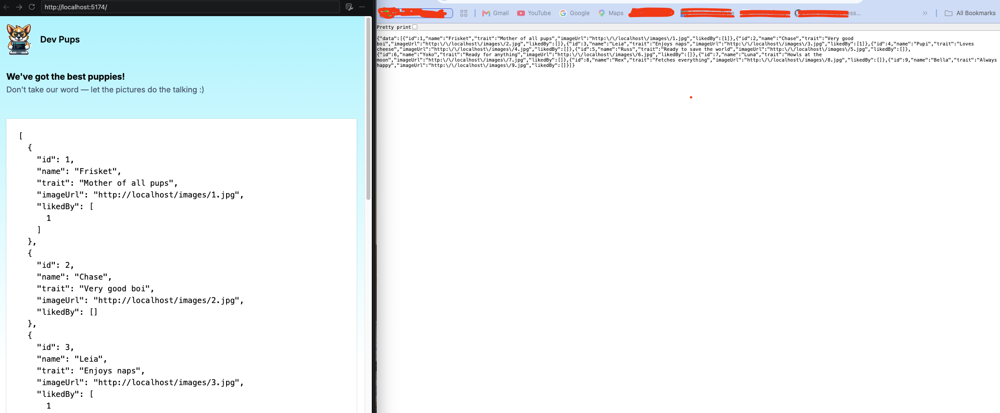

## React "Hello World" Preview

- we can use HTML tags in JS sections of code, such as using div, h1, p tags

## JSX

*JSX (JavaScript XML) is a syntax extension for JS that let's you write HTML-like markup directly inside JS files. It is not valid JS or HTML alone, it must be used alongside the Babel compiler or Vite bundler which transforms JSX tags into standard JS function calls (such as React.createElement()) 

You can use JS expressions (variables, function calls, loops) directly inside JSX by wrapping in curly braces {}

Due to JSX compiling JS, some HTML attributes change name to avoid reserved language keywords (using className instead of class)*

- looks like HTML but has functionality of JS under the hood
- MUST use 'className' attribute instead of 'class' in tags such as ``` <ul className="new-list"></ul> ```
    - 'class' attribute is reserved key word in JS
- Must use either ``` <React.Fragment></React.Fragment> or <></> to place multiple top-level elements.

## Components

Components can help to maintain a clean codebase. We create an exportable function (makes the function globally accessible), and then import the function into the required files. We should keep functions in their relevant files to ensure code readability is easier.

## Context API

 provides a way to share data globally across components without prop drilling. It allows creating a lightweight global state accessible by any component.

 ## Data Fetching with useEffect

 - We created another project 'react-from-scratch-api' which posts array of puppy data to the browser. This React project calls that endpoint and receives this data through its UI.

 

 ### Lesson outcome

Creating a small API opened my eyes to how extremely easy it is to create and utilise APIs within a system. I initially thought it would be more complex than this but it actually couldn't be easier.