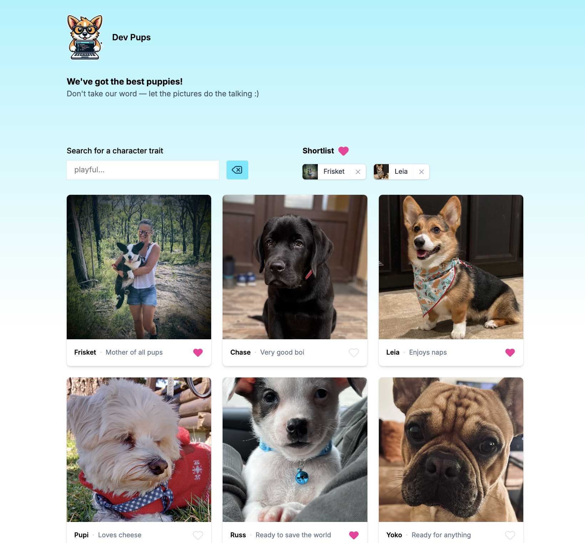
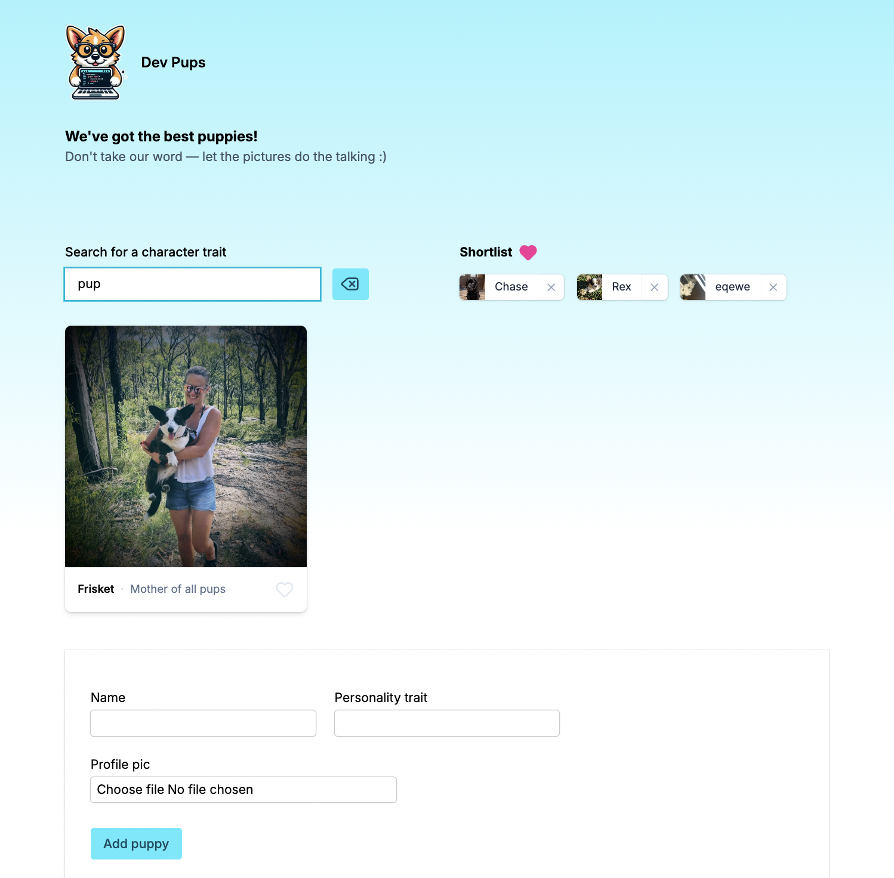
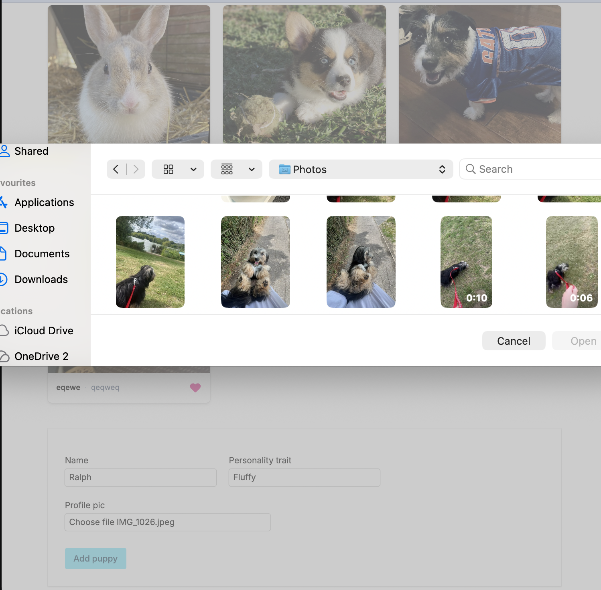

# React-from-scratch

This repo follows along with the React course tutorial on Laracast by Simon Vrachliotis.

This project works alongside 

https://github.com/Dec-246/react-from-scratch-api



Search Bar



Adding new post via form submission




## How to run

1. Install dependencies:

   ```
   npm install
   ```

2. Start the dev server:

   ```
   npm run dev
   ```

3. Start the API from the [API repo](https://github.com/Dec-246/react-from-scratch-api) (requires PHP 8.4):

   ```
   php artisan serve
   ```

   The API runs at `http://127.0.0.1:8000/api/puppies`.